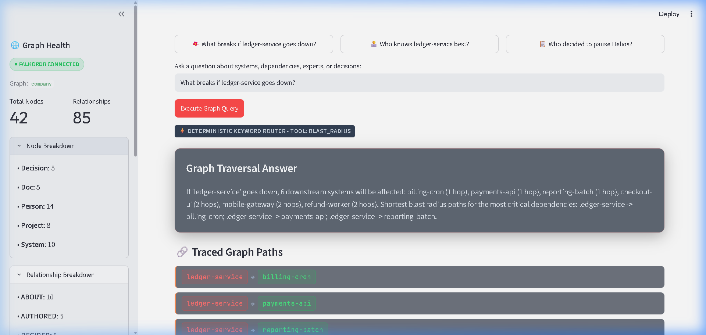

# Why Vector RAG Fails Blast-Radius Questions (and the 4-Hop Cypher Query That Fixes It)

*By the Blast Radius Brain Team — Submitted for Graph Hacks: Give Your AI Agents Real Context (Track 03: Company Brain)*

---

Imagine it’s 3:15 AM on a Saturday. PagerDuty sounds the alarm: **`ledger-service` is throwing 500 errors and degraded latency.**

As the incident commander, your first three urgent questions are:
1. **What downstream services and user workflows are breaking right now?**
2. **Who is the deepest domain expert to pull into the war room?**
3. **Did anyone recently push a change, rollout, or migration to this service?**

If your AI assistant is backed by standard **Vector RAG (Retrieval-Augmented Generation)**, you are in trouble.

Here is why vector search breaks down on organizational architecture questions—and how a deterministic graph agent powered by **FalkorDB** solves it in sub-millisecond query time.

---

## The Vector RAG Trap: Similarity is Not Topology

Vector RAG converts unstructured text chunks into high-dimensional embeddings and performs cosine similarity search. When you ask:

> *"What breaks if ledger-service goes down?"*

A vector database searches for documents containing words semantically similar to *"breaks"*, *"ledger-service"*, and *"down"*. It might return:
- The `ledger-service` on-call runbook.
- A Slack thread from six months ago mentioning a database failover.
- A README mentioning *"In case of breakage..."*

What it **cannot** do is compute transitive closure across an architecture diagram:
- It doesn't know that `checkout-ui` depends on `payments-api`.
- It doesn't know that `payments-api` depends on `ledger-service`.
- It cannot traverse: `checkout-ui` $\rightarrow$ `payments-api` $\rightarrow$ `ledger-service`.

**Vector embeddings flatten topology.** A relationship path is not a semantic similarity; it is a directed graph traversal. When you ask an LLM to "figure out" multi-hop dependencies from vector snippets, you invite hallucinations, omitted dependencies, and unverified assumptions during an active outage.

---

## The Solution: A Graph-Load-Bearing Agent ("Blast Radius Brain")

To solve this, we built **Blast Radius Brain**: an agent over a simulated enterprise technology and team graph ("Aurora Labs"). 

The design principle is simple:
> **The graph is load-bearing. The LLM is only a router and explainer. Every answer must be a deterministic Cypher traversal with verifiable provenance.**


*Figure 1: Blast Radius Brain interface showing visual path chips, executed Cypher, and verified graph rows.*

---

## The Aurora Labs Data Model

Our schema models the socio-technical graph of an engineering organization across 5 node types and 8 relationship types:

```
 (Person) ---[:WORKS_ON]---> (Project) ---[:USES]---> (System)
    |                           |                       |
    +-------[:LEADS]------------+                       ^
    |                                            [:DEPENDS_ON]
    +-------[:AUTHORED]--------> (Doc)                  |
    |                             |                     |
    |                             +------[:ABOUT]-------+
    |                                                   |
    +-------[:DECIDED]---------> (Decision)             |
                                  |                     |
                                  +---[:DECIDED_IN]-----+
                                  +---[:ABOUT]----------+
```

### Nodes:
- **`System`**: Microservices, frontends, batches, gateways (e.g., `ledger-service`, `payments-api`, `checkout-ui`).
- **`Person`**: Engineers, leads, SREs, managers (e.g., `Maya Chen`, `Diego Ramos`, `Nora Haddad`).
- **`Project`**: Active business initiatives (e.g., `Helios`, `Atlas`, `Zephyr`).
- **`Decision`**: Architectural decision records (ADRs), rollout pauses, deprecations.
- **`Doc`**: Runbooks, postmortems, migration guides.

---

## The Three Mission-Critical Queries

### 1. Multi-Hop Blast Radius Traversal
When `ledger-service` fails, what breaks downstream? We execute a variable-length incoming traversal (`<-[:DEPENDS_ON*1..5]-`):

```cypher
MATCH path = (s:System {name: $system})<-[:DEPENDS_ON*1..5]-(downstream:System)
RETURN downstream.name AS affected_system,
       length(path) AS hops,
       [n IN nodes(path) | n.name] AS node_path,
       [r IN relationships(path) | type(r)] AS rel_path
ORDER BY hops, affected_system
```

#### What Happens:
In FalkorDB, this evaluates across sparse adjacency matrices in under 2ms. FalkorDB returns:
- **1-hop direct dependencies**: `billing-cron`, `payments-api`, `reporting-batch`
- **2-hop cascading dependencies**: `checkout-ui`, `mobile-gateway`, `refund-worker`

The agent extracts the canonical minimum-hop paths and returns visual path chips:
- `ledger-service → payments-api → checkout-ui`
- `ledger-service → payments-api → refund-worker`

### 2. Team Expertise Join
Who is the best person to paged for `ledger-service`? Don't rely on stale team wiki pages; query active project commitment:

```cypher
MATCH (p:Person)-[:WORKS_ON]->(proj:Project)-[:USES]->(s:System {name: $system})
RETURN p.name AS person, p.role AS role, p.team AS team,
       collect(DISTINCT proj.name) AS projects,
       count(DISTINCT proj) AS score
ORDER BY score DESC, person
LIMIT 5
```

#### What Happens:
The graph aggregates all engineers working on projects that utilize `ledger-service`. It ranks **Maya Chen** (Staff Engineer) first with a score of 3 (`Helios`, `Atlas`, `Zephyr`), followed by **Diego Ramos** and **Marco Silva**.

### 3. Decision Provenance & Context
Why was a project paused or modified?

```cypher
MATCH (dec:Decision)
WHERE toLower(dec.title) CONTAINS toLower($q)
   OR toLower(dec.summary) CONTAINS toLower($q)
OPTIONAL MATCH (dec)-[:DECIDED_IN]->(proj:Project)
OPTIONAL MATCH (author:Person)-[:DECIDED]->(dec)
OPTIONAL MATCH (dec)-[:ABOUT]->(s:System)
RETURN dec.title AS decision, dec.date AS date, dec.status AS status,
       dec.summary AS summary, proj.name AS project,
       author.name AS decided_by,
       collect(DISTINCT s.name) AS systems
ORDER BY date DESC
LIMIT 5
```

#### What Happens:
Querying `Helios` uncovers:
> *"Pause Helios rollout" (Status: paused, Date: 2026-09-12). Decided by Nora Haddad for project Helios affecting ledger-service. Summary: "Rollout paused after ledger-service latency regression in staging."*

We immediately correlate the infrastructure regression with an existing managerial decision record.

---

## The Zero-Hallucination "Evidence Contract"

LLM agents are notorious for fabricating details. In Blast Radius Brain, every tool call strictly returns an **Evidence Contract**:

```json
{
  "tool": "blast_radius",
  "question": "What breaks if ledger-service goes down?",
  "answer": "If 'ledger-service' goes down, 6 downstream systems will be affected...",
  "cypher": "MATCH path = (s:System {name: $system})<-[:DEPENDS_ON*1..5]-(downstream:System)...",
  "params": {"system": "ledger-service"},
  "evidence": {
    "nodes": [{"id": 2, "label": "System", "name": "ledger-service"}, ...],
    "paths": [
      ["ledger-service", "payments-api", "checkout-ui"],
      ["ledger-service", "payments-api", "refund-worker"]
    ],
    "rows": [...]
  }
}
```

If an LLM API key (OpenAI/Anthropic) is configured, the LLM serves purely to map natural language queries to tool parameters. If no key is set, the system falls back to a 100% deterministic keyword router. **The app never fails due to an API outage or missing token.**

---

## Why FalkorDB?

1. **Cypher Compatibility**: Full open Cypher support makes queries intuitive and readable.
2. **GraphBLAS Acceleration**: FalkorDB leverages linear algebra (matrix multiplication) over graph adjacency matrices, executing 5-hop path explorations in single-digit milliseconds.
3. **Idempotent Ingestion**: With Cypher's `MERGE` and `UNWIND`, database initialization scripts can run repeatedly in CI/CD without creating duplicate entities or broken relationships.
4. **Developer Experience**: One docker command gives you both the Redis-compatible graph engine and an interactive visual browser on port 3000.

---

## Conclusion

Vector embeddings are great for unstructured semantic search, but enterprise operations, security blast radius, and dependency management require mathematical certainty.

By making the knowledge graph load-bearing and using Cypher traversal as the source of truth, **Blast Radius Brain** provides incident responders with verifiable, hallucination-free intelligence when seconds count.

---
*Built with FalkorDB, Streamlit, and Python. Open-source repository: [Blast Radius Brain](https://github.com/)*
