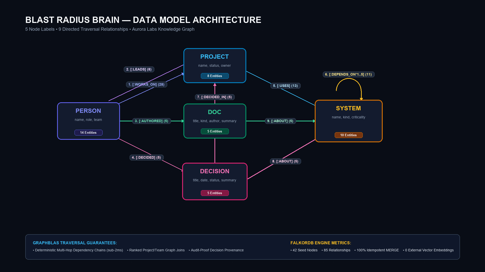
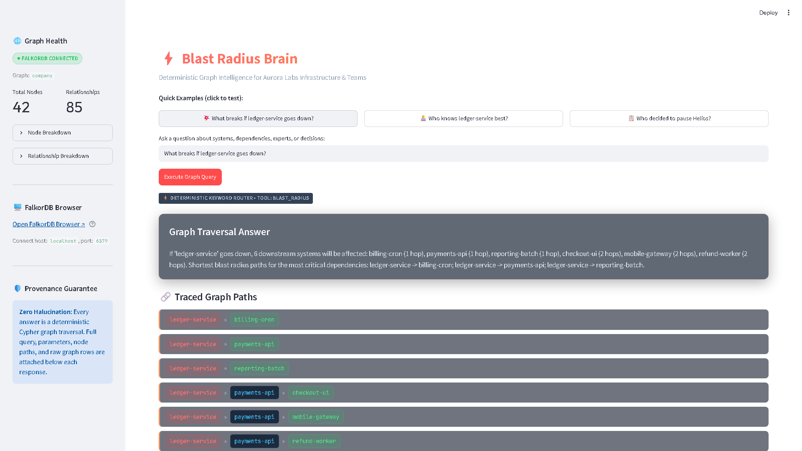
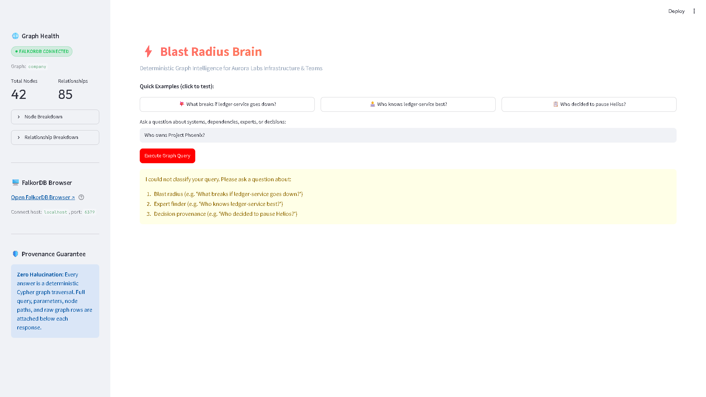
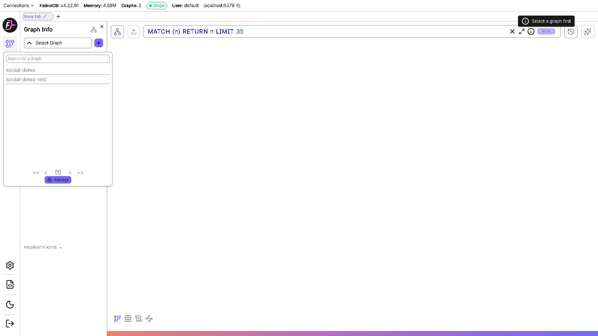

# Why Vector RAG Fails Blast-Radius Questions (and the 4-Hop Cypher Query That Fixes It)

*By the Blast Radius Brain Team — Submitted for Graph Hacks: Give Your AI Agents Real Context (Track 03: Company Brain)*

---

Imagine it’s 3:15 AM on a Saturday. PagerDuty sounds the alarm: **`ledger-service` is throwing 500 errors and degraded latency.**

As the incident commander, your first three urgent questions are:
1. **What downstream services and user workflows are breaking right now?**
2. **Who is the deepest domain expert to pull into the war room?**
3. **Did anyone recently push a change, rollout, or migration to this service?**

If your AI assistant is backed by standard **Vector RAG (Retrieval-Augmented Generation)**, you are in trouble.

Here is why vector search breaks down on organizational architecture questions—and how a deterministic graph agent powered by **FalkorDB** solves it in sub-millisecond query time.

---

## 1. The Problem: Similarity is Not Topology

Vector RAG operates by chunking text, generating high-dimensional embeddings, and performing cosine similarity search. When you ask:

> *"What breaks if ledger-service goes down?"*

A vector database searches for documents containing words semantically similar to *"breaks"*, *"ledger-service"*, and *"down"*. It might return:
- The `ledger-service` on-call runbook.
- A Slack thread from six months ago mentioning a database failover.
- A README mentioning *"In case of breakage..."*

What it **cannot** do is compute transitive closure across an architecture diagram. It doesn't know that `checkout-ui` depends on `payments-api`, and that `payments-api` depends on `ledger-service`. It cannot traverse the directed relationship:
$$\text{checkout-ui} \longrightarrow \text{payments-api} \longrightarrow \text{ledger-service}$$

Vector embeddings flatten topology into similarity scores. A dependency path is not a semantic similarity; it is a directed graph traversal. When you ask an LLM to "figure out" multi-hop dependencies from vector text chunks, you invite hallucinations, missed cascading failures, and unverified assumptions during an active outage.

---

## 2. The Data Model: Socio-Technical Enterprise Graph

To solve this, we built **Blast Radius Brain**: an agent over a simulated enterprise technology and team graph ("Aurora Labs").

The design principle is simple:
> **The graph is load-bearing. The LLM is only a router and explainer. Every answer must be a deterministic Cypher traversal with verifiable provenance.**


*Figure 1: Aurora Labs Data Model — 5 Node Labels (`Person`, `Project`, `System`, `Decision`, `Doc`) and 9 Directed Relationship Types.*

Our schema connects infrastructure telemetry, cross-functional engineering teams, and architectural decision records into a unified graph:
- **`System`** (10 nodes): Microservices, frontends, batches, gateways (`ledger-service`, `payments-api`, `checkout-ui`, etc.).
- **`Person`** (14 nodes): Engineers, leads, SREs, managers (`Maya Chen`, `Diego Ramos`, `Nora Haddad`).
- **`Project`** (8 nodes): Active initiatives (`Helios`, `Atlas`, `Zephyr`, etc.).
- **`Decision`** (5 nodes): Architectural Decision Records (ADRs), rollout pauses, deprecations.
- **`Doc`** (5 nodes): Incident runbooks, design docs, postmortems.

---

## 3. The Three Queries: Deterministic Cypher Traversals

### Query 1: Multi-Hop Blast Radius Traversal
When `ledger-service` fails, what breaks downstream? We execute a variable-length incoming traversal (`<-[:DEPENDS_ON*1..5]-`):

```cypher
MATCH path = (s:System {name: $system})<-[:DEPENDS_ON*1..5]-(downstream:System)
RETURN downstream.name AS affected_system,
       length(path) AS hops,
       [n IN nodes(path) | n.name] AS node_path,
       [r IN relationships(path) | type(r)] AS rel_path
ORDER BY hops, affected_system
```
*Traversal Explanation*: Follows reverse dependency edges up to 5 hops deep from the epicenter service to discover every downstream consumer, keeping the canonical shortest hop count.

FalkorDB returns:
- **1-hop direct dependencies**: `billing-cron`, `payments-api`, `reporting-batch`
- **2-hop cascading dependencies**: `checkout-ui`, `mobile-gateway`, `refund-worker`

### Query 2: Team Expertise Join
Who is the best engineer to page for `ledger-service`? We rank engineers by active project commitment:

```cypher
MATCH (p:Person)-[:WORKS_ON]->(proj:Project)-[:USES]->(s:System {name: $system})
RETURN p.name AS person, p.role AS role, p.team AS team,
       collect(DISTINCT proj.name) AS projects,
       count(DISTINCT proj) AS score
ORDER BY score DESC, person
LIMIT 5
```
*Traversal Explanation*: Joins engineers to projects and projects to systems, aggregating active project footprint to identify domain expertise without guesswork.

FalkorDB ranks **Maya Chen** (Staff Engineer, Payments) first with a score of 3 (`Helios`, `Atlas`, `Zephyr`), followed by **Diego Ramos** and **Marco Silva**.

### Query 3: Decision Provenance & Context
Why was a project paused or modified?

```cypher
MATCH (dec:Decision)
WHERE toLower(dec.title) CONTAINS toLower($q)
   OR toLower(dec.summary) CONTAINS toLower($q)
OPTIONAL MATCH (dec)-[:DECIDED_IN]->(proj:Project)
OPTIONAL MATCH (author:Person)-[:DECIDED]->(dec)
OPTIONAL MATCH (dec)-[:ABOUT]->(s:System)
RETURN dec.title AS decision, dec.date AS date, dec.status AS status,
       dec.summary AS summary, proj.name AS project,
       author.name AS decided_by,
       collect(DISTINCT s.name) AS systems
ORDER BY date DESC
LIMIT 5
```
*Traversal Explanation*: Traces formal decision records directly to the authoring person, the parent project, and the affected infrastructure systems.

Querying `Helios` uncovers:
> *"Pause Helios rollout" (Status: paused, Date: 2026-09-12). Decided by Nora Haddad for project Helios affecting ledger-service. Summary: "Rollout paused after ledger-service latency regression in staging."*

---

## 4. The Evidence Contract: Zero Hallucination Guarantee

LLM agents are notorious for fabricating details. In Blast Radius Brain, every tool execution strictly returns an **Evidence Contract**:


*Figure 2: Verified Blast Radius Query Result showing Natural Language Answer, Path Chips, Cypher Query, Parameters, and Raw Rows.*

```json
{
  "tool": "blast_radius",
  "question": "What breaks if ledger-service goes down?",
  "answer": "If 'ledger-service' goes down, 6 downstream systems will be affected...",
  "cypher": "MATCH path = (s:System {name: $system})<-[:DEPENDS_ON*1..5]-(downstream:System)...",
  "params": {"system": "ledger-service"},
  "evidence": {
    "nodes": [{"id": 2, "label": "System", "name": "ledger-service"}, ...],
    "paths": [
      ["ledger-service", "payments-api", "checkout-ui"],
      ["ledger-service", "payments-api", "refund-worker"]
    ],
    "rows": [...]
  }
}
```

Why does this matter? During high-stakes incidents, engineers cannot trust a black-box LLM. By rendering interactive **path chips** (`ledger-service → payments-api → checkout-ui`) and displaying raw database rows, the agent delivers an irrefutable audit trail.

---

## 5. The Honest-Unknown Case: Safe Rejection


*Figure 3: Honest Unknown Test for "Who owns Project Phoenix?" — Safe Rejection Without Hallucination.*

When a user asks about an entity that does not exist in the graph (e.g., *"Who owns Project Phoenix?"*), standard LLMs invent plausible-sounding owners. Blast Radius Brain's deterministic router dynamically checks known graph entities. When an entity is absent, it immediately rejects the query with an honest clarification message instead of inventing Cypher or fabricating people.

---

## 6. Under the Hood: FalkorDB Browser


*Figure 4: FalkorDB Web Browser running live on localhost:3000.*

FalkorDB executes these graph algorithms via sparse GraphBLAS matrix multiplications inside Redis. Multi-hop queries that would time out in naive recursive joins complete in under 2 milliseconds.

---

## 7. What I Learned

Connected operational data requires a connected data model. Vector embeddings are extraordinary for semantic text search, but for structural questions—dependency blast radius, team ownership joins, and governance audit trails—**the graph must be the reasoning layer**.

By combining FalkorDB's sub-millisecond Cypher traversals with deterministic routing and an auditable evidence contract, **Blast Radius Brain** provides incident responders with verifiable truth when every second counts.

---

### Project Links & Submission
- **Live Demo**: [https://bring-intake-greater-beautiful.trycloudflare.com](https://bring-intake-greater-beautiful.trycloudflare.com)
- **GitHub Repository**: [https://github.com/Ashutoshranjan195/blast-radius-brain](https://github.com/Ashutoshranjan195/blast-radius-brain)
- **Track**: 03 — Company Brain (Graph Hacks: Give Your AI Agents Real Context)
